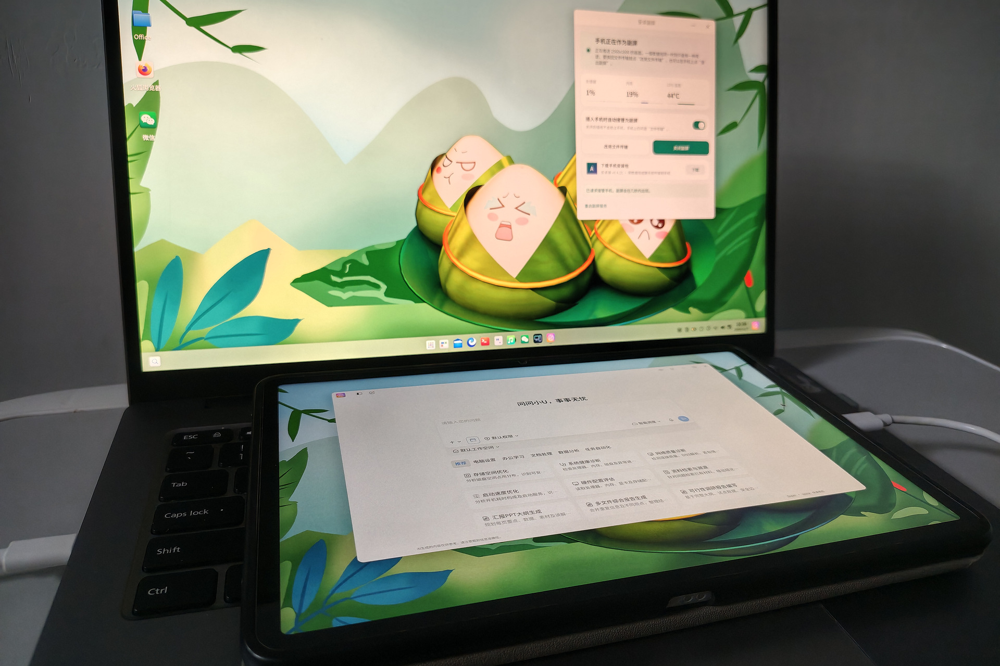
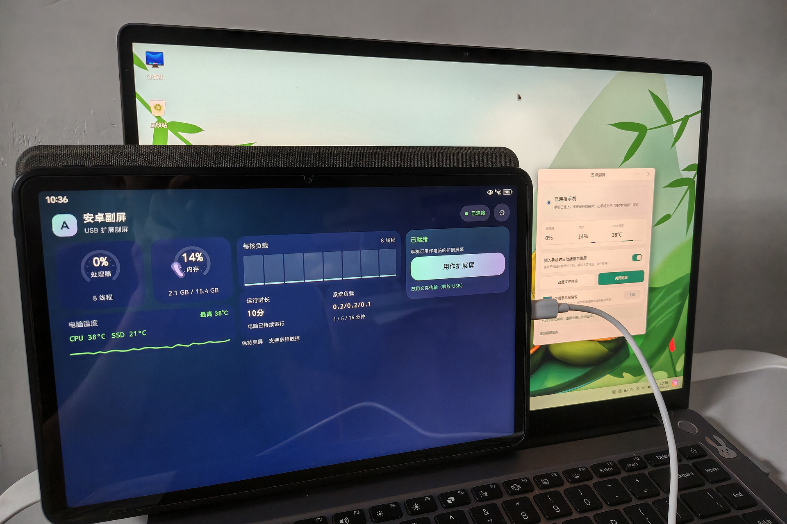
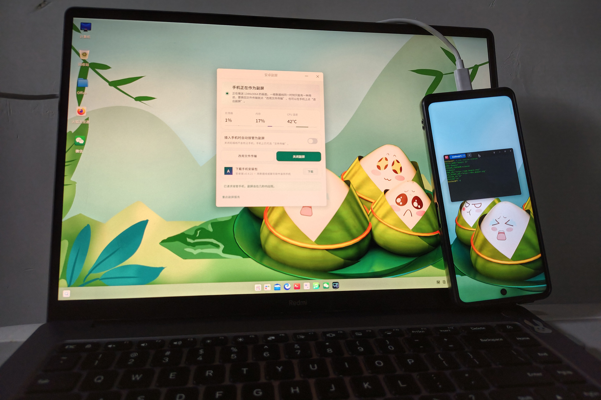
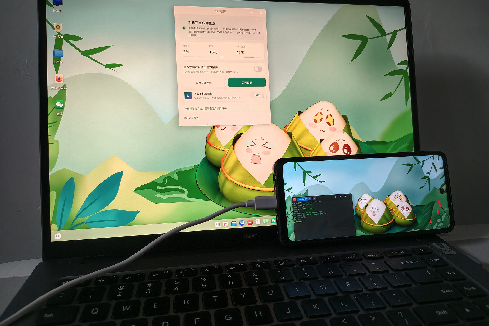
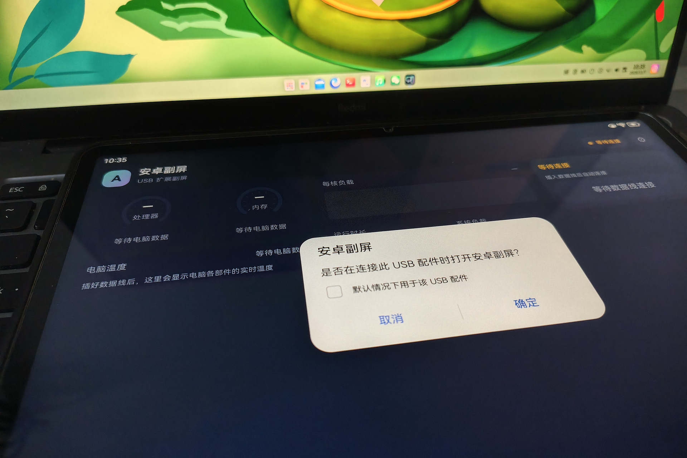
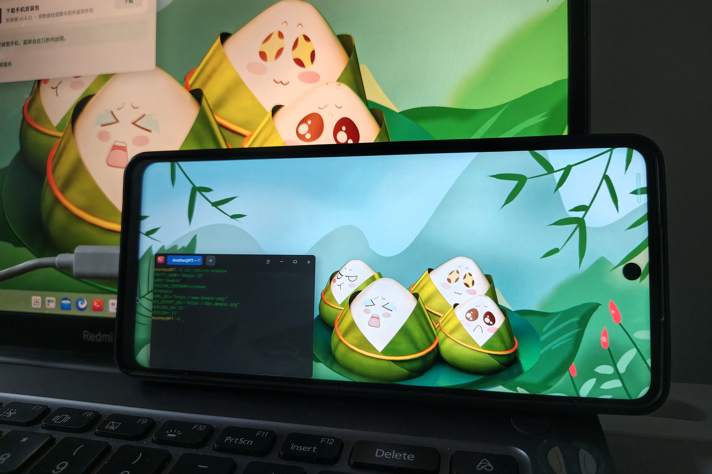
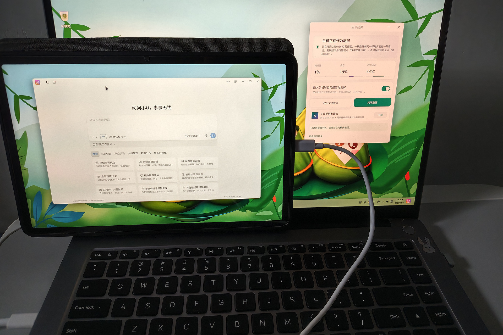
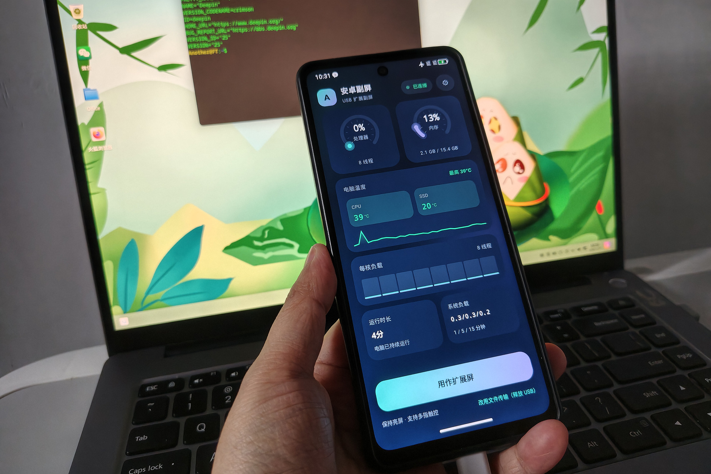
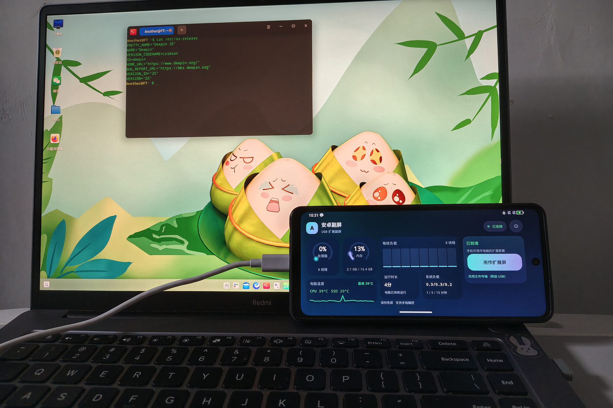
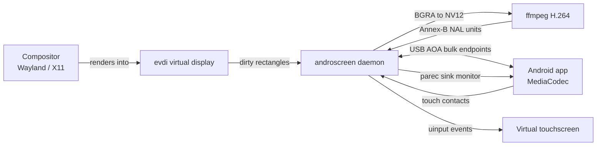

# AndroScreen

**English** | [简体中文](README.zh-CN.md)

[](https://github.com/GBooter/androscreen/releases)
[](#requirements)
[](https://www.rust-lang.org)
[](#license)

Turn an Android phone into a real second monitor over a single USB cable — no USB
debugging, no Wi-Fi, no app store, no drivers on the phone.



The desktop sees a normal monitor. The phone decodes the picture with its own
hardware decoder and reports touches as a native multi-touch panel, so you can
drag windows onto it and interact with them directly.

## Features

- **One cable, no debugging** — the host speaks the Android Open Accessory
  protocol, so the phone never has to enable ADB.
- **Extended, not mirrored** — a virtual output is created through `evdi` and
  handed to the compositor like any other monitor.
- **H.264 over USB** — frames are encoded by `ffmpeg` on the host and decoded by
  `MediaCodec` on the phone, keeping the link at a few tens of Mbps.
- **Real multi-touch** — contacts are injected through `/dev/uinput` as a
  protocol-B touchscreen, so pinch, drag and scroll work in every app.
- **Audio included** — desktop output is captured from the default sink monitor
  and played on the phone (48 kHz stereo).
- **Cursor stays smooth** — the pointer is drawn by the phone from cursor events,
  so it follows the mouse at the panel's refresh rate instead of the video rate.
- **Wayland and X11** — Treeland/wlroots outputs are enabled through
  `zwlr_output_manager_v1`; X11 layouts are applied with `xrandr`.
- **DDE/deepin aware** — the display service owns the layout on deepin, so the
  virtual monitor is registered through it, and the laptop brightness is
  preserved when the extra output comes and goes.
- **Settings window** — a Slint UI shows live statistics, can take over the phone
  automatically on plug-in, and can enroll the DKMS signing key for Secure Boot.

## Screenshots

| Phone app | Host settings |
| --- | --- |
|  |  |
| **Extended desktop** | **Plug-in flow** |
|  |  |
| **Lying flat** | **Tablet-sized phone** |
|  |  |

<table>
  <tr>
    <td width="50%"></td>
    <td width="50%"></td>
  </tr>
</table>

## How it works



The daemon waits for a phone, switches it to accessory mode with an AOA
handshake, connects an `evdi` card whose EDID describes the phone panel, then
streams the grabbed frames as H.264 while forwarding input and audio in the
opposite direction.

## Requirements

- Linux desktop on Wayland (Treeland / wlroots) or X11; deepin/UOS 23+ is the
  reference desktop.
- Kernel headers and DKMS to build the bundled `evdi` 1.15.1 module.
- `libusb-1.0-0`, `ffmpeg`, `pulseaudio-utils` (installed automatically by the
  package).
- Android 8.0 or newer (minSdk 26) with USB accessory support.
- A USB cable with data lines — charge-only cables will not work.

## Install

Download the package from the [releases page](https://github.com/GBooter/androscreen/releases),
then:

```bash
sudo apt install ./androscreen_0.4.29_amd64.deb
sha256sum -c androscreen_0.4.29_amd64.deb.sha256   # optional
```

The package installs the daemon, the settings window, udev rules, the evdi DKMS
source and the phone app at `/usr/share/androscreen/androscreen.apk`.

1. Plug the phone in and pick **File transfer** when Android asks.
2. Open the phone app (or install the bundled APK) and allow the USB accessory.
3. Tap **用作扩展屏 / Use as extended display**.

The desktop settings window shows the connected device, live statistics and a
toggle to take the phone over automatically whenever it is plugged in.

## Usage

```bash
androscreen --version      # print the version
androscreen --stats        # host statistics as JSON
androscreen --usb-scan     # list USB devices and their accessory status
androscreen --usb-probe    # switch a phone to accessory mode and wait
androscreen --evdi-scan    # list evdi virtual display cards
androscreen --layout-scan  # print the desktop layout reported by the compositor
```

Running `androscreen` with no arguments starts the daemon. It is normally managed
by `systemctl --user status androscreen`; logs go to the user journal.

## Build from source

```bash
cargo build --release --locked
./packaging/build-deb.sh          # produces packaging/out/androscreen_<version>_<arch>.deb
```

The package build also compiles the Android app with Gradle. The release
certificate is not part of the repository; point the build at your own keystore
through `android/local.properties`:

```properties
androscreen.storeFile=/absolute/path/to/androscreen-release.keystore
androscreen.storePassword=...
androscreen.keyAlias=androscreen
androscreen.keyPassword=...
```

The same values can be supplied as `ANDROSCREEN_STORE_FILE`,
`ANDROSCREEN_STORE_PASSWORD`, `ANDROSCREEN_KEY_ALIAS` and
`ANDROSCREEN_KEY_PASSWORD`.

## Project layout

| Path | Purpose |
| --- | --- |
| `crates/core` | Wire protocol, control messages, touch and EDID codecs |
| `crates/host` | Daemon: AOA transport, evdi, encoder, input, audio, layout |
| `crates/panel` | Desktop settings window (Slint) |
| `android/` | Kotlin/Compose phone app with a MediaCodec pipeline |
| `packaging/` | deb build script, systemd units, udev rules, evdi patches |
| `vendor/winit` | Patched winit build used by the settings window |

## Troubleshooting

- **No phone found** — reload the udev rules after installing, then check the
  device: `sudo udevadm control --reload-rules && sudo udevadm trigger
  --subsystem-match=usb`, followed by `androscreen --usb-scan`.
- **Black phone screen** — confirm the module is loaded (`lsmod | grep evdi`) and
  read the daemon log: `journalctl --user -u androscreen -e`.
- **Secure Boot** — the DKMS module has to be signed. The settings window offers
  to enroll a signing key (MOK); the machine reboots into the blue MOK screen and
  the password shown there is the one to type.
- **Package manager conflict** — the package provides its own evdi build, so
  `evdi-dkms` and `evdi-source` must be removed first.

## License

GNU General Public License v3.0 — see [LICENSE](LICENSE).

Copyright (C) 2026 GBooter.
