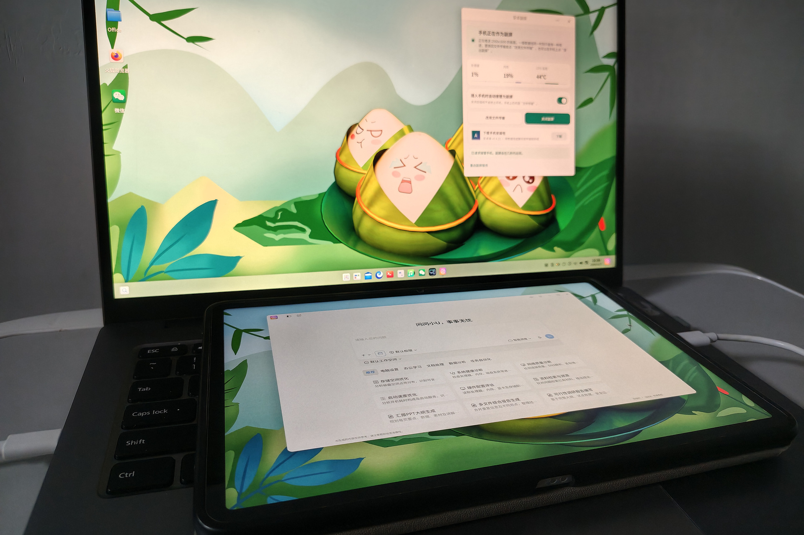
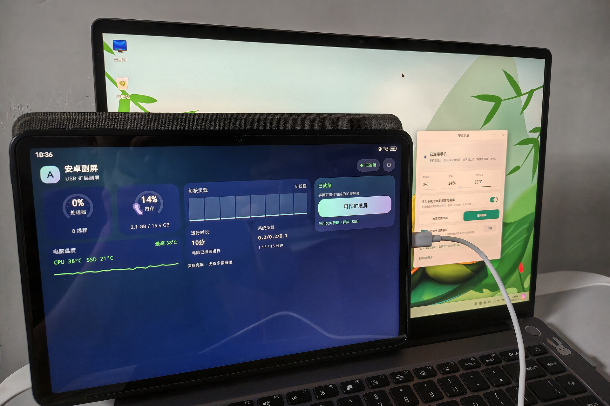
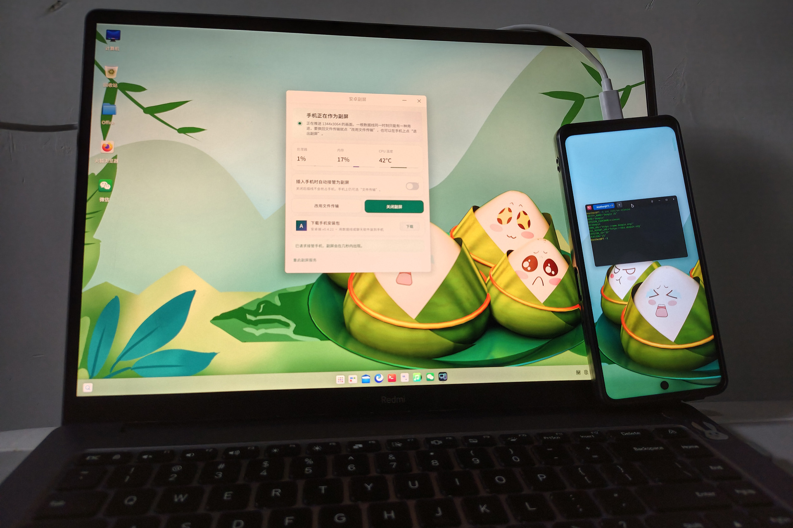
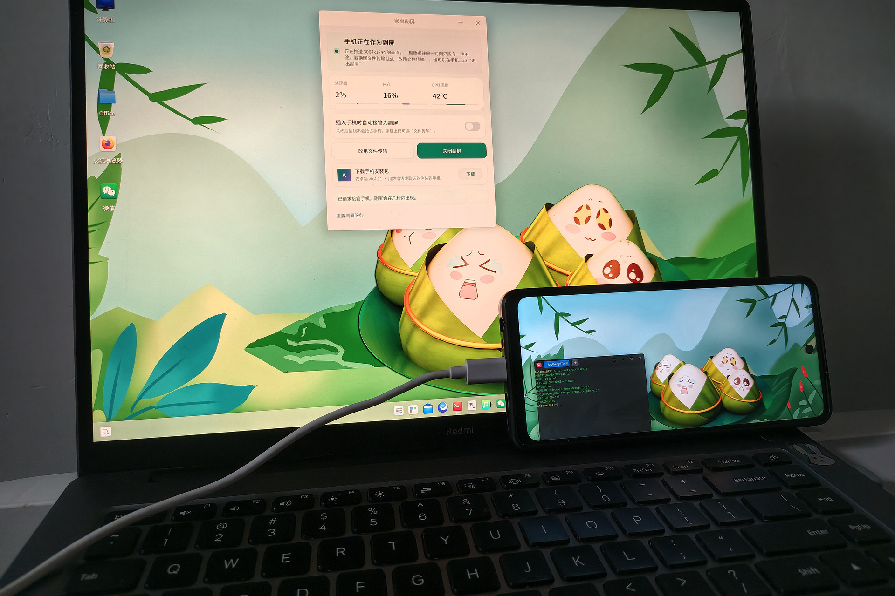
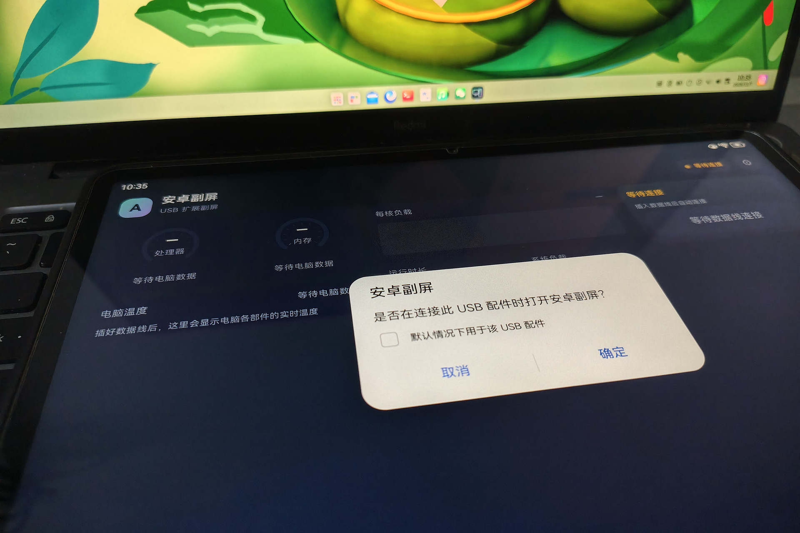
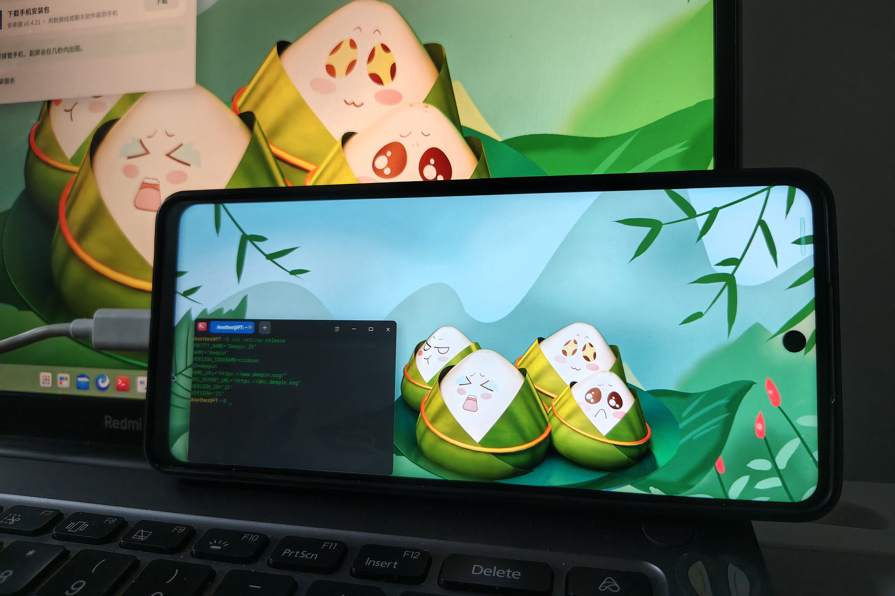
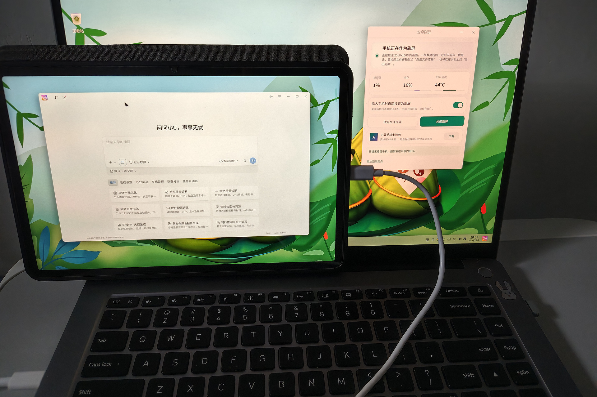
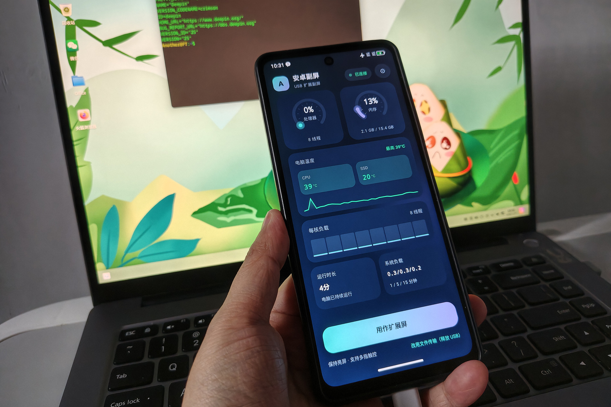
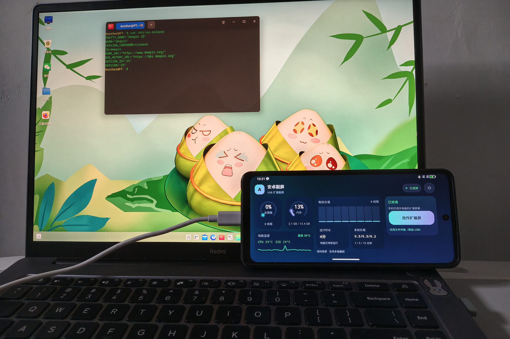
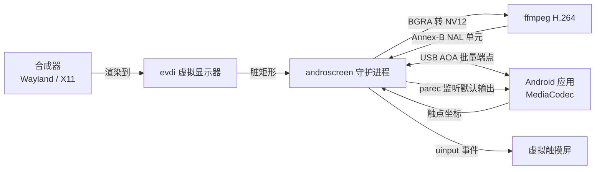

# 安卓副屏 AndroScreen

[English](README.md) | **简体中文**

[](https://github.com/GBooter/androscreen/releases)
[](#环境要求)
[](https://www.rust-lang.org)
[](#许可协议)

一根 USB 数据线，把 Android 手机变成真正的第二块显示器：不用开 USB 调试、不依赖 Wi‑Fi、不用装驱动、也不用从应用商店下载。



桌面会把手机当成一块普通显示器：可以把窗口拖进去。手机端用硬件解码播放画面，并把触摸上报成一块原生多点触控屏，所以拖拽、缩放、滚动和在笔记本上一样可用。

## 功能特性

- **一根线，免调试** —— 主机走 Android Open Accessory 协议，手机无需打开 ADB。
- **扩展而非镜像** —— 通过 `evdi` 创建虚拟输出，交给合成器当作普通显示器排版。
- **USB 上的 H.264** —— 主机用 `ffmpeg` 编码，手机用 `MediaCodec` 硬解，链路只需几十 Mbps。
- **真多点触控** —— 触点经 `/dev/uinput` 注入为 protocol-B 触摸屏，捏合、拖拽、滚动在所有应用中都有效。
- **声音一起过去** —— 从默认输出设备的 monitor 采集桌面声音，在手机上以 48 kHz 立体声播放。
- **光标不卡顿** —— 指针由手机根据光标事件自行绘制，跟随鼠标的刷新率，而不是视频帧率。
- **Wayland 与 X11** —— Treeland/wlroots 通过 `zwlr_output_manager_v1` 启用输出，X11 用 `xrandr` 应用布局。
- **适配 DDE/deepin** —— deepin 上布局归显示服务所有，因此虚拟显示器交由它登记；副屏来去时也不会把笔记本亮度顶到 100%。
- **设置窗口** —— Slint 界面展示实时统计，可在插线时自动接管手机，也能为 Secure Boot 登记 DKMS 签名密钥。

## 截图

| 手机端面板 | 桌面设置窗口 |
| --- | --- |
|  |  |
| **扩展桌面** | **插线流程** |
|  |  |
| **平放使用** | **大屏手机** |
|  |  |

<table>
  <tr>
    <td width="50%"></td>
    <td width="50%"></td>
  </tr>
</table>

## 工作原理



守护进程等待手机插入，用 AOA 握手把它切换到配件模式，接入一块 EDID 与手机面板匹配的 `evdi` 显卡，随后把抓到的画面编码成 H.264 发出去，同时反向转发触摸与音频。

## 环境要求

- Linux 桌面，Wayland（Treeland / wlroots）或 X11；参考环境为 deepin/UOS 23 及以上。
- 内核头文件与 DKMS，用于编译随包附带的 `evdi` 1.15.1 模块。
- `libusb-1.0-0`、`ffmpeg`、`pulseaudio-utils`（由安装包自动安装）。
- Android 8.0 及以上（minSdk 26），且支持 USB 配件模式。
- 带数据线的 USB 线；只能充电的线不可用。

## 安装

从 [Releases 页面](https://github.com/GBooter/androscreen/releases) 下载安装包，然后：

```bash
sudo apt install ./androscreen_0.4.31_amd64.deb
sha256sum -c androscreen_0.4.31_amd64.deb.sha256   # 可选，校验完整性
```

安装包会装上守护进程、设置窗口、udev 规则、evdi 的 DKMS 源码，以及位于 `/usr/share/androscreen/androscreen.apk` 的手机端应用。

首次安装在 X11 桌面上需要重启一次：登录期间加载显卡驱动会让 deepin 25.3 的桌面卡死，所以安装包把它留到下次开机，设置窗口会显示“重启后即可使用副屏”并给出一个“立即重启”按钮。Treeland/Wayland 会话不需要重启，后续升级也不需要。

1. 插上手机，Android 弹出提示时选择 **文件传输**。
2. 打开手机端应用（或安装随包的 APK），允许 USB 配件访问。
3. 点 **用作扩展屏**。

桌面设置窗口会显示已连接的设备、实时统计，以及“插入手机时自动设为副屏”的开关。

## 使用

```bash
androscreen --version      # 打印版本
androscreen --stats        # 以 JSON 输出主机统计
androscreen --usb-scan     # 列出 USB 设备及其配件状态
androscreen --usb-probe    # 把手机切到配件模式并等待握手
androscreen --evdi-scan    # 列出 evdi 虚拟显示卡
androscreen --layout-scan  # 打印合成器报告的桌面布局
```

不带参数运行 `androscreen` 即启动守护进程，通常由 `systemctl --user status androscreen` 管理，日志写入用户 journal。

## 从源码构建

```bash
cargo build --release --locked
./packaging/build-deb.sh          # 生成 packaging/out/androscreen_<版本>_<架构>.deb
```

打包过程还会用 Gradle 编译手机端应用。发布证书不在仓库中，请通过 `android/local.properties` 指向你自己的 keystore：

```properties
androscreen.storeFile=/absolute/path/to/androscreen-release.keystore
androscreen.storePassword=...
androscreen.keyAlias=androscreen
androscreen.keyPassword=...
```

也可以用环境变量提供同样的四个值：`ANDROSCREEN_STORE_FILE`、`ANDROSCREEN_STORE_PASSWORD`、`ANDROSCREEN_KEY_ALIAS`、`ANDROSCREEN_KEY_PASSWORD`。

## 目录结构

| 路径 | 作用 |
| --- | --- |
| `crates/core` | 通信协议、控制消息、触摸与 EDID 编解码 |
| `crates/host` | 守护进程：AOA 传输、evdi、编码器、输入、音频、布局 |
| `crates/panel` | 桌面设置窗口（Slint） |
| `android/` | Kotlin/Compose 手机端，含 MediaCodec 管线 |
| `packaging/` | deb 构建脚本、systemd 单元、udev 规则、evdi 补丁 |
| `vendor/winit` | 设置窗口使用的 winit 补丁分支 |

## 常见问题

- **找不到手机** —— 安装后先重载 udev 规则：
  `sudo udevadm control --reload-rules && sudo udevadm trigger --subsystem-match=usb`，
  再用 `androscreen --usb-scan` 确认设备。
- **手机黑屏** —— 确认模块已加载（`lsmod | grep evdi`），并查看日志：
  `journalctl --user -u androscreen -e`。
- **Secure Boot** —— DKMS 模块必须签名。设置窗口可以登记签名密钥（MOK），重启后在蓝色 MOK 界面输入窗口里给出的密码。
- **包管理器冲突** —— 本包自带 evdi 构建，需要先移除 `evdi-dkms` 与 `evdi-source`。

## 许可协议

GNU 通用公共许可证第 3 版，全文见 [LICENSE](LICENSE)。

版权所有 (C) 2026 GBooter。
